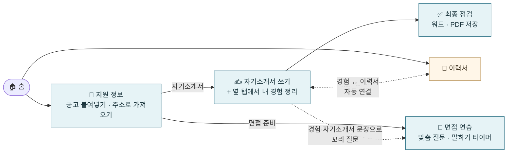
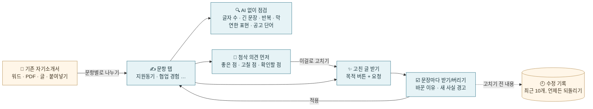
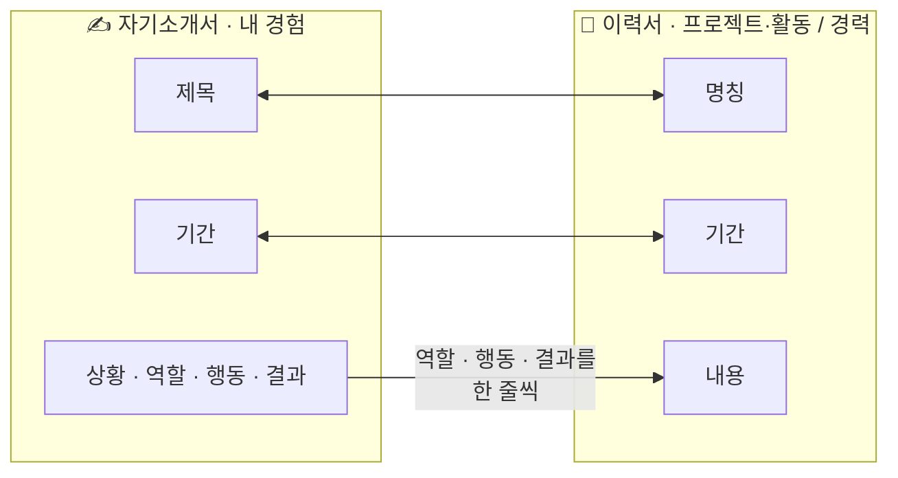
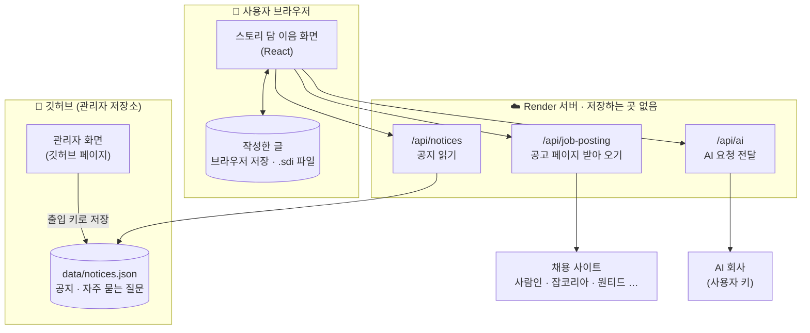

<div align="center">


# 스토리 담 이음 · Story Dam Ieum

**지금까지의 경험을, 다음 기회로 이어 주는 다리**<br />
담이와 함께 채용공고를 읽고, 자기소개서·이력서·면접을 한곳에서 준비하는 웹사이트예요.

### [👉 사이트 바로가기 — story-dam-ieum.onrender.com](https://story-dam-ieum.onrender.com/)


</div>

> [!NOTE]
> 무료 서버를 쓰고 있어서, 한동안 아무도 들어오지 않았다면 **첫 접속이 1분 정도** 걸릴 수 있어요. 화면에 "서버를 깨우고 있어요"가 보이면 잠시만 기다려 주세요.

<br />

## ✨ 이런 걸 할 수 있어요

| | 기능 | 설명 |
| :-: | --- | --- |
| 📌 | **공고 가져오기** | 채용공고를 붙여넣거나 **주소만 넣으면** 회사명·직무·주요 업무·자격요건·우대사항·마감일을 찾아 채워요. 사람인·잡코리아·원티드 실제 공고로 확인했어요. |
| ✍️ | **자기소개서** | 쓰는 화면 오른쪽 **'내 경험' 탭**에서 경험을 정리하고, **본문에 넣기**로 바로 옮겨요. 문항별 글자 수(공백 포함·제외·바이트)를 세어 줘요. 다른 지원서에 써 둔 문항도 골라서 가져올 수 있어요. |
| 🩹 | **기존 자기소개서 고치기** | 써 둔 자기소개서(워드·PDF·글)를 **불러오면 문항별로 나눠** 넣어요. AI 첨삭은 문항·글자 수·공고·내 경험을 함께 보고 고치고, 바뀐 문장을 **하나씩 받거나 버릴 수** 있어요. 고치기 전 내용은 **수정 기록**에 남아요. AI 없이도 반복 단어·긴 문장·막연한 표현을 점검해요. |
| 🔗 | **이력서 자동 연결** | 자기소개서에 정리한 경험이 이력서 '프로젝트·활동/경력'에 **저절로** 들어가요. 한쪽에서 고치면 다른 쪽도 함께 바뀌어요. |
| 🎤 | **면접 연습** | 기본 질문 5개에 답하고, **공고·내 자기소개서 문장으로 꼬리 질문**을 받아요. 답을 말하면 몇 초쯤 걸리는지 알려 주고, **30초·1분·1분 30초 타이머**로 소리 내어 연습해요. |
| 🤖 | **AI 도움 (선택)** | 내 API 키를 넣으면 자기소개서 첨삭·면접 추가 질문·공고 읽기를 AI가 도와줘요. Claude·Gemini·ChatGPT 중 고르고, 회사마다 **균형형 / 가장 똑똑함 / 빠르고 저렴** 모델을 고르거나 새 모델 이름을 직접 넣을 수 있어요. |
| 📄 | **내보내기** | 워드(DOCX)·PDF로 저장하고, 작업 전체는 `.sdi` 파일로 보관·불러오기 해요. |
| 🗂️ | **지원서 여러 개** | 회사별로 지원서를 따로 만들고, 홈 목록에 D-day를 붙여 **마감 가까운 순**으로 보여 줘요. |
| 🙋 | **처음 써 보는 사람도** | **예시로 채워 보기**로 흐름을 먼저 둘러보고, 버튼이 막히면 **무엇을 채워야 하는지** 알려 줘요. AI 키가 필요한 곳엔 **AI 키 넣기** 버튼이 바로 있어요. **글씨 크게** 보기(가+), 휴대폰 **홈 화면에 추가**, 카카오톡 **링크 미리보기**도 돼요. |
| 🔒 | **내 기기에만 저장** | 작성한 글은 **서버에 저장하지 않아요.** 브라우저와 내가 내려받은 파일에만 남아요. |

<br />

## 🧭 이렇게 이어져요

자기소개서와 면접 준비는 **지원할 공고부터** 시작해요. 이력서는 공고 없이 바로 만들 수 있어요.



<br />

## 🖼️ 화면 둘러보기

### 1. 홈 — 오늘 준비할 일 고르기
자기소개서·이력서·면접 준비를 고르고, 회사별 지원서를 관리해요.


### 2. 지원 정보 — 공고에서 항목 찾기
공고 글을 붙여넣거나 채용 사이트 주소를 넣으면, 적혀 있는 항목만 찾아서 채워요(AI가 지어내지 않아요). 찾은 내용은 꼭 원문과 비교해 확인하도록 안내해요. 위쪽 메뉴는 어느 화면에서나 같고, 지금 단계(① 지원 정보 › ② 자기소개서 › ③ 최종 점검)는 본문 위 한 줄로 보여요. 처음이라면 오른쪽 **예시로 채워 보기**를 눌러 보세요.


### 3. 자기소개서 — 경험을 보며 쓰기
오른쪽 칸은 **담이에게 요청하기**(AI 첨삭·점검)와 **내 경험** 두 탭으로 나뉘어 있어요. '내 경험' 탭에서 상황·역할·행동·결과를 정리하고 **본문에 넣기**를 누르면, 커서 자리에 내용이 들어가요. 넣은 뒤에는 내 말투로 다듬으면 돼요.


### 4. 이력서 — 경험이 저절로 들어와요
자기소개서에서 정리한 경험이 '프로젝트·활동'에 **내 경험과 연결됨** 표시와 함께 들어와 있어요.


<table>
<tr>
<td width="50%" valign="top">

### 5. 면접 연습
질문에 하나씩 답하고, 옆에서 공고와 내 경험을 함께 봐요. **맞춤 질문 받기**로 꼬리 질문을 더하고, 타이머로 말하기 연습을 해요.


</td>
<td width="50%" valign="top">

### 6. 최종 점검
문항별 글자 수와 사실 확인 항목을 체크하고 워드·PDF로 저장해요.


</td>
</tr>
</table>

<details>
<summary><b>📱 휴대폰에서 보기</b></summary>
<br />


화면이 좁으면 메뉴는 ☰ 버튼 안으로 들어가고, 오른쪽 칸(담이에게 요청하기 · 내 경험)은 본문 아래로 내려가요. 진행 그림은 휴대폰에서 화면을 따라다니지 않아요.
</details>

> 화면 속 회사·사람·경험은 모두 예시예요.

<br />

## 🩹 기존 자기소개서 고치기

예전에 써 둔 자기소개서를 이 공고에 맞게 고치는 흐름이에요.



<table>
<tr>
<td width="340" valign="top">

</td>
<td valign="top">

- **불러오기:** “1. 지원동기”, “[문항 2]”, “Q3)” 같은 제목을 찾아 문항별로 나눠요. 제목 옆 “(500자)”는 글자 수 제한으로 읽어요. 한글(HWP)은 PDF나 워드로 저장한 뒤 불러와 주세요.
- **함께 보내는 정보:** 문항 제목, 글자 수 제한과 세는 방법, 지원 공고(회사·직무·주요 업무·자격요건), '이번 자기소개서에 사용'으로 고른 내 경험.
- **목적 버튼:** 글자 수에 맞추기 · 두괄식으로 · 이 공고에 맞추기 · 구체적으로 · 중복 줄이기 · 맞춤법·문장 다듬기.
- **문장별로 받기:** 바뀐 문장을 지운 줄(빨강)과 새 문장(초록)으로 보여 주고, 문장마다 받을지 골라요. 적용하면 몇 자가 되는지도 미리 보여 줘요.
- **사실 지키기:** 원문·내 경험·공고에 없던 숫자나 영문 이름(예: 30%, AWS)이 생기면 경고해요. AI에게도 없는 사실을 만들지 말고 '확인할 점'으로 묻게 했어요.
- **끊긴 답 막기:** AI 답이 길이 제한에 걸려 중간에 끊기면 적용하지 않고 알려 줘요.

</td>
</tr>
</table>

<br />

## 🔗 경험 ↔ 이력서 자동 연결

같은 경험을 두 번 쓰지 않도록, **경험 하나 = 이력서 항목 하나**로 이어 둬요.



- **제목·기간**은 어느 쪽에서 고쳐도 같아져요.
- **내용**은 경험의 역할·행동·결과로 채워져요. 이력서에서 직접 고치면 그 내용은 그대로 남고, "경험 내용으로 다시 채우기"로 되돌릴 수 있어요.
- 경험마다 '프로젝트·활동 / 경력 / 넣지 않기'를 고를 수 있고, 이력서에서 **연결 끊기**도 돼요.
- 예전에 저장한 `.sdi` 파일도 그대로 열려요. 이력서에 같은 제목이 이미 있으면 새로 만들지 않고 그 항목과 이어 줘요.

<br />

## 📌 공고 주소로 가져오기

| 사이트 | 결과 (2026-10-15, 실제 공고 9개 시험) |
| --- | --- |
| 원티드 | 3개 모두 5개 항목 채움 |
| 잡코리아 | 글로 된 공고 2개 모두 5개 항목 채움 · 공고 본문이 따로 있는 안쪽 창까지 읽음 |
| 사람인 | 표로 된 공고도 부문별로 정리 · 안쪽 창 읽기 · 화면에 안 보이는 검색용 글은 제외 |
| 그림으로만 된 공고 | 글자가 없어 읽을 수 없어요 → 회사명·직무만 채우고 "직접 옮겨 적어 주세요" 안내 |

- 서버가 못 가져오면 **AI로 다시 시도**를 눌러, 내가 넣은 AI 키로 AI가 페이지를 읽게 할 수 있어요.
- 안전장치: http/https 주소만, 내부망 주소 차단, 최대 3MB·10초, 우리 화면에서 온 요청만, 같은 사람은 10분에 20번까지.

<br />

## 🏗️ 어떻게 이루어져 있나요



- 서버는 **공지 읽기 · 공고 받아 오기 · AI 요청 전달** 세 가지만 하고, 아무것도 저장하지 않아요.
- 개인 AI 키는 브라우저 탭 메모리에만 있고, 새로고침하면 사라져요.

### 🤖 고를 수 있는 AI 모델

오른쪽 위 ⚙️ **AI 설정**에서 AI 회사, 모델, 내 API 키를 넣어요. 모델 목록은 [`shared/aiModels.ts`](shared/aiModels.ts) 한 파일에 모여 있어서, 이름이 바뀌면 그 파일만 고치면 돼요. 목록에 없는 모델은 **직접 입력**으로 쓸 수 있어요.

| AI | 균형형 (기본) | 가장 똑똑함 | 빠르고 저렴 |
| --- | --- | --- | --- |
| Claude | `claude-sonnet-5-5` | `claude-opus-5-5` | `claude-haiku-5-5` |
| Gemini | `gemini-3.8-flash` | `gemini-4-argon` | `gemini-3.5-flash-lite` |
| ChatGPT | `gpt-6.1-sol` | `gpt-6-astra` | `gpt-6-luna` |

<sub>2026-10-15 각 회사 공식 문서 기준. 요금은 모델마다 다르고, 사용한 만큼 각 AI 회사가 키 주인에게 청구해요.</sub>
- 공지는 별도 폴더(`admin-app`)의 관리자 화면에서 쓰고, 그 저장소의 `data/notices.json`에 저장돼요.

<br />

## 🚀 내 컴퓨터에서 실행하기

Node.js **22.12 이상**이 필요해요.

```powershell
npm install
npm run dev          # http://127.0.0.1:5173
```

공지를 보려면 `.env.example`을 복사해 `.env`를 만들고 `NOTICES_URL`을 채워 주세요. 없으면 "게시된 공지가 없습니다"로 나와요.

| 명령 | 하는 일 |
| --- | --- |
| `npm run typecheck` | 코드 형식 오류 확인 |
| `npm run lint` | 코드 규칙 확인 |
| `npm test` | 자동 테스트 79개 (처음 한 번: `npx playwright install chromium`) |
| `npm run build` | 배포용 파일 만들기 (`dist/`, `dist-server/`) |
| `npm start` | 만든 배포용 파일로 서버 실행 (http://localhost:3000) |
| `npm run check:job -- 주소…` | 실제 채용공고를 가져올 수 있는지 시험 (`urls.txt`처럼 주소 목록 파일도 가능, 결과는 `test-results/job-check.md`) |

<br />

## ☁️ Render에 올리기

1. 이 폴더를 깃허브 저장소로 올려요.
2. Render → **+ New → Blueprint** → 저장소를 고르면 `render.yaml`대로 서버가 만들어져요.
3. **Environment**에 값을 넣어요.

   | 이름 | 값 |
   | --- | --- |
   | `NOTICES_URL` | 관리자 화면 아래 "사용자 사이트 연결"에 나오는 공지 파일 주소 |
   | `AI_OPENAI_MODEL` · `AI_GEMINI_MODEL` · `AI_CLAUDE_MODEL` | (선택) 기본 모델을 바꾸고 싶을 때만. 비우면 위 표의 균형형 모델을 써요 |

4. 이후에는 깃허브에 `git push`하면 Render가 자동으로 다시 배포해요.

<details>
<summary>무료 서버가 잠들지 않게 하려면</summary>

Render 무료 서버는 15분 동안 접속이 없으면 잠들어요. UptimeRobot 같은 무료 감시 서비스에 `https://story-dam-ieum.onrender.com/api/health`를 10분마다 확인하도록 등록하면 깨어 있어요(월 750시간 무료 범위 안에서).
</details>

<br />

## 📁 폴더 구조

```text
src/                 화면
├─ App.tsx             주소별 화면 연결(작업 화면은 필요할 때 불러옴), 머리글(같은 메뉴)·단계 줄, 작업 파일 불러오기, 공지 알림
├─ pages/              화면별 파일 (Login, Home, Application, CoverLetter, Resume, Interview, Review, Notices)
├─ components/         같이 쓰는 부품 (담이, 진행률 다리, 내 경험 칸 ExperienceBox, AI 첨삭 칸 LetterCoach, 불러오기 LetterImport, AI 설정 등)
├─ letterTools.ts      자기소개서 문장 비교, 새 사실 경고, AI 없는 점검, 문항 나누기
├─ interviewTools.ts   면접 맞춤 질문 만들기, 말하는 시간 어림
├─ model.ts            작업 데이터 형식, 진행률, .sdi 검사, 경험↔이력서 연결 규칙, 예시 채우기
├─ store.tsx           작업 상태, 지원서 여러 개, 브라우저 임시저장
├─ export.ts           워드·PDF 만들기
└─ services.ts         파일 읽기, 서버 요청(AI·공고·공지)
server/              Render에서 돌아가는 서버
├─ app.ts              /api 기능 모음
├─ jobPage.ts          공고 페이지에서 글·항목 뽑기 (사이트별 맞춤 처리 포함)
├─ safeFetch.ts        안전하게 페이지 받아 오기
├─ ai.ts               AI 요청 전달 (끊긴 답 감지)
└─ letterAi.ts         자기소개서 첨삭 지시문·답 읽기
shared/              화면과 서버가 같이 쓰는 규칙 (공고 항목 찾기, 공지 형식, AI 모델 목록)
scripts/check-job.ts 실제 공고 가져오기 시험 도구
tests/               자동 테스트 (화면 · 서버 · 경험 연결 · 시험용 공고 페이지)
public/              글꼴, 아이콘, 앱 정보(manifest.json), 링크 미리보기 그림(og-image.png)
docs/                개발 기록, 디자인 안내, README 화면 캡처
```

<br />

## 📝 개발 기록

작업 내용·오류·해결 과정은 **[docs/dev-log](docs/dev-log/DEV_LOG_INDEX.md)** 에 주 단위로 남기고 있어요.

| 날짜 | 주요 변경 |
| --- | --- |
| 2026-10-19 | 편의성 개선: 어느 화면에서나 같은 메뉴, 막힌 버튼 안내, 예시로 채워 보기, AI 키 바로가기, 자기소개서 오른쪽 탭, 면접 맞춤 질문·타이머, 다른 지원서 문항 가져오기, 마감순 정렬, 글씨 크게, 링크 미리보기·홈 화면 추가, 첫 화면 가볍게 |
| 2026-10-19 | 기존 자기소개서 고치기: 불러오기·문항 나누기, 문맥을 함께 보내는 AI 첨삭, 첨삭 의견, 문장별 받기, 새 사실 경고, 수정 기록, AI 없는 점검 / 휴대폰 홈 배치, 그림 공고 AI 다시 시도 |
| 2026-10-15 | AI 설정에서 회사별 모델 고르기(균형형·가장 똑똑함·빠르고 저렴 + 직접 입력), README 새로 씀, 첫 화면 로고·제목 겹침 수정 |
| 2026-10-15 | 자기소개서·면접은 공고부터 시작, '내 경험'을 쓰기 화면에 합침, 경험↔이력서 자동 연결, 실제 공고 9개로 사이트별 맞춤 처리, Render 배포 |
| 2026-10-15 | 지원서 여러 개, 백업 알림, 글자 수 세는 방법, 마감일 D-day, 새 공지 표시, AI로 공고 읽기 |
| 2026-10-14 | 사용자 사이트(Render)와 관리자 화면(깃허브 페이지) 분리, 서버를 Node 하나로 단순화, 코드 정리 |

<div align="center">
<br />
<sub>담이와 함께, 당신의 다음을 응원합니다 🦫</sub>
</div>
